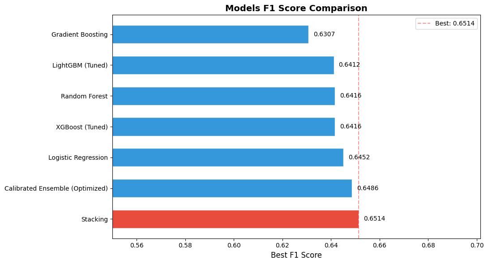
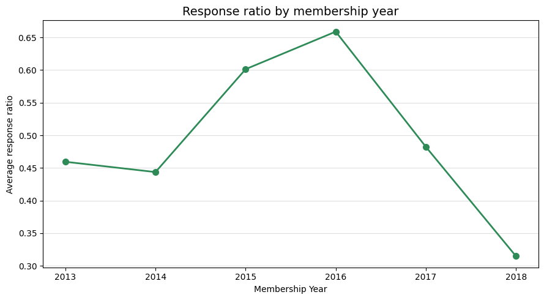
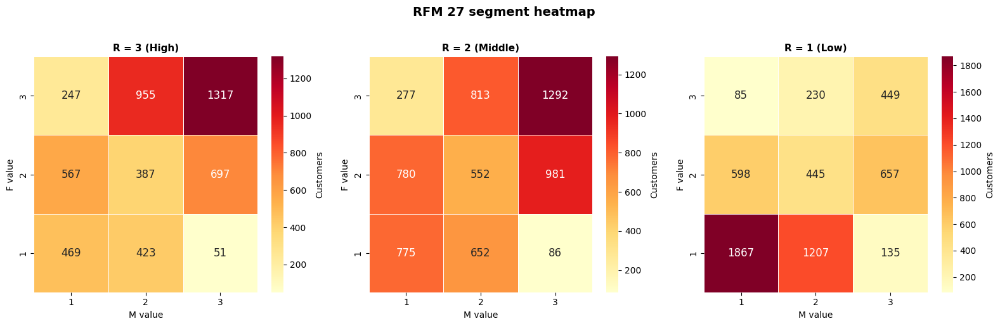

# Customer Analytics — Churn Prediction, Offer Response & RFM Segmentation

Customer-data projects covering the full CRM analytics loop: **predicting who will leave**,
**building a customer-level data mart from raw event logs**, **segmenting customers by value** and
turning the results into targeting strategy.

| Project | Question | Methods | Key result |
|---|---|---|---|
| [Churn prediction](churn-prediction/) | Which telecom customers will churn? | Feature engineering, Optuna-tuned XGBoost/LightGBM, calibrated ensemble, stacking | Stacking model: **ROC-AUC 0.844**, F1 0.651, recall 0.692 |
| [Offer response mart](starbucks-offer-response/) | How do customers respond to BOGO vs discount offers? | ERD, event-log → customer mart, χ² and Welch t-tests | Discount offers completed more often than BOGO (**0.644 vs 0.572**); women respond more (0.564 vs 0.431, p < 0.001) |
| [RFM segmentation](starbucks-rfm-segmentation/) | Who are the high-value and at-risk customers? | Vectorised mart (pivot tables), RFM tercile scoring, 27 segments → 3 grades | VIP customers (42%) respond to **65%** of offers vs **18%** for at-risk customers |
| [CRM case study](starbucks-crm-case-study/) | How does Starbucks run CRM? | 3C analysis, CRM activities, data strategy | Presentation deck |

Notebooks are written in Korean (university course projects); this README summarises them in English.

---

## 1. Telco customer churn prediction

**Data:** [Telco Customer Churn](https://www.kaggle.com/datasets/blastchar/telco-customer-churn) (IBM sample data) —
7,043 customers, 21 columns, 26.5% churn. Split fixed by the assignment: first 5,000 rows train, last 2,043 rows test.

**Approach**
- EDA with χ² tests (categorical) and t-tests (numeric) against churn
- 17 engineered features — e.g. month-to-month × tenure interaction, a "risky profile" flag
  (month-to-month + fibre + no online security), services count, charge per service, auto-pay flag, log charges
- Models: class-weighted Logistic Regression, Random Forest, Gradient Boosting; XGBoost and LightGBM tuned with
  **Optuna** (50 trials, 5-fold stratified CV F1 on the training set)
- Isotonic probability calibration, F1-optimised ensemble weights (Nelder–Mead) and a stacking classifier

**Results (test set, 2,043 customers)**

| Model | F1 | Threshold |
|---|---:|---:|
| **Stacking** | **0.651** | 0.620 |
| Calibrated weighted ensemble | 0.649 | 0.350 |
| Logistic Regression | 0.645 | 0.570 |
| XGBoost (Optuna) | 0.642 | 0.615 |
| Random Forest | 0.642 | 0.515 |
| LightGBM (Optuna) | 0.641 | 0.595 |
| Gradient Boosting | 0.631 | 0.285 |

Final model (stacking): accuracy 0.798, precision 0.615, recall 0.692, F1 0.651, **ROC-AUC 0.844** —
it finds 385 of 556 churners. Month-to-month contracts, short tenure and fibre internet without
support services are the strongest churn drivers.



> **Limitation:** thresholds, ensemble weights and the final model were chosen by F1 on the test set, so the
> test scores are optimistic. Selecting them on the internal validation split would give an unbiased estimate.
> All seven models land within 0.02 F1 of each other, so the simpler logistic regression is a reasonable production choice.

## 2. Starbucks offer response — customer-centric data mart

**Data:** Starbucks Capstone Challenge (Udacity Data Scientist Nanodegree) — simulated Starbucks rewards-app data:
`portfolio` (10 offers), `profile` (17,000 customers), `transcript` (306,534 events over ~30 days).

**Approach**
- ERD of the three tables (`profile 1:N transcript`, `portfolio 1:N transcript`)
- Parse the event log and aggregate it into a **one-row-per-customer mart**: offers received/completed by type,
  transaction count and amount, response ratios (completed ÷ received)
- Segment customers by BOGO and discount response (> 0.5) into *BOGO*, *DC*, *BOGO & DC*, *no preference*
- Statistical tests: gender × segment (χ²), response by gender (Welch t-test), response by age and membership year

**Findings (14,820 customers with demographics)**
- Discount offers are completed more often than BOGO offers (mean response 0.644 vs 0.572; median 1.0 vs 0.67).
- Women respond more than men (0.564 vs 0.431; Welch t = −24.6, p < 0.001); segment mix differs by gender (χ² = 614, p < 0.001).
- Response rises with age, from 0.34 (teens) to ~0.51–0.54 (50+). Members who joined in 2015–2016 respond best (0.60–0.66); 2018 joiners respond least (0.31).
- A third of customers (34%) are *no preference* — they complete half or fewer of both offer types.
- Informational offers never generate an "offer completed" event, so their effect has to be measured through transactions, not completion rate.



## 3. Starbucks RFM segmentation

Extends the mart from project 2 with a **vectorised pivot-table pipeline** (≈0.4 s instead of ~8 min for the per-customer loop).

- **R** = time of last transaction, **F** = number of transactions, **M** = total spend — each scored 1–3 by terciles → 27 segments
- RFM total (3–9) → **VIP** (7–9), **Normal** (5–6), **At risk** (3–4)

| Grade | Customers | Avg. transactions | Avg. spend | Offer response |
|---|---:|---:|---:|---:|
| VIP | 7,189 (42.3%) | 12.3 | 175.6 | 0.651 |
| Normal | 5,358 (31.5%) | 6.6 | 73.0 | 0.376 |
| At risk | 4,447 (26.2%) | 3.4 | 27.3 | 0.176 |

- Income is almost identical across grades (~65K), so value is driven by behaviour, not income.
- Women are more often VIP (49.6% vs 43.9%) and less often at risk (20.3% vs 25.8%); χ² = 70.6, p < 0.001.
- The grade mix is fairly even across age groups (VIP share 43–51%).
- **Strategy:** concentrate offer budget on VIPs (highest response), use low-difficulty discount offers to re-activate at-risk customers, and measure informational offers by follow-up transactions.



## 4. Starbucks CRM case study

[`starbucks_crm_strategy.pptx`](starbucks-crm-case-study/starbucks_crm_strategy.pptx) — B2C CRM analysis of Starbucks
(Korean): 3C analysis, product- vs customer-centric CRM, core CRM activities (recognition, personalisation via Deep Brew,
two-way communication), data strategy, and an assessment of strengths and weaknesses.

---

## Repository structure

```
churn-prediction/             churn_prediction.ipynb + figures/
starbucks-offer-response/     starbucks_offer_response_mart.ipynb + figures/
starbucks-rfm-segmentation/   starbucks_rfm_segmentation.ipynb + figures/
starbucks-crm-case-study/     starbucks_crm_strategy.pptx
data/README.md                where to download the datasets
requirements.txt
```

## How to run

```bash
pip install -r requirements.txt
# download the datasets into data/ (see data/README.md)
jupyter notebook
```

The notebooks keep the outputs of the original Google Colab runs. For this repository the data paths were made portable
(local `data/` folder, Colab fallback), the conclusions in the RFM and offer notebooks were corrected to match their own
outputs, and all three notebooks were re-executed end to end on synthetic data with the same schema to check that they run.

## Tech stack

Python · pandas · NumPy · SciPy · scikit-learn · XGBoost · LightGBM · Optuna · DuckDB · Matplotlib · Seaborn
